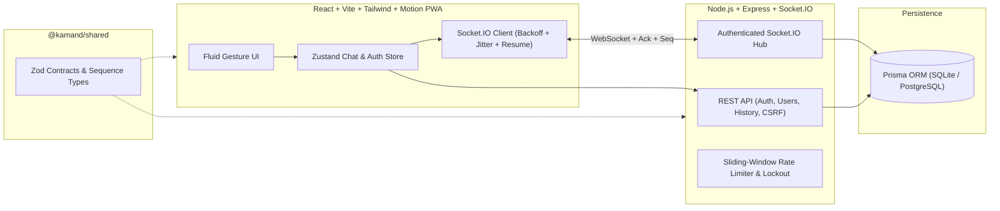

# Kamand Chat

**Start with a conversation. Build whatever comes next.**  
Built for **First Commit** (24-Hour Hackathon by Kamand Prompt, Programming Club, IIT Mandi).

Kamand Chat is a real-time, fluid web messenger designed for the IIT Mandi campus community. It combines reliable low-latency WebSocket communication, strict security defaults, and an Apple WWDC-inspired fluid physics interface.

---

## 1. Architecture Overview



### Real-Time Communication & Ordering Guarantees
- **Authenticated Handshake**: WebSocket connections validate the HTTP-only `kamand_sid` session cookie before joining user or conversation rooms.
- **Idempotent Delivery**: Every outbound message carries a client-generated UUID (`id`). Retries after a network drop never duplicate rows (`@id` primary key + idempotent lookup on `(conversationId, id)`).
- **Total Per-Conversation Ordering**: The server assigns a strictly increasing integer `seq` per conversation inside a transaction. Clients sort messages by `seq` and track `lastSeenSeq`.
- **Automatic Reconnect & Catch-Up**: On disconnect, the client reconnects with exponential backoff + full jitter and immediately emits `sync:resume` with its `lastSeenSeq` map to fetch any missed messages without gaps.

---

## 2. Quick Start (Clean Environment Reproduction)

### Prerequisites
- Node.js >= 20.x and npm >= 10.x

### One-Command Setup & Run
```bash
# 1. Copy environment variables
cp server/.env.example server/.env
cp client/.env.example client/.env

# 2. Install dependencies, build shared contracts, push Prisma schema & seed demo users
npm run setup

# 3. Start both backend (http://localhost:4000) and frontend (http://localhost:5173)
npm run dev
```

### Seeded Demo Accounts (Password for all: `Kamand@2026!`)
| Username | Email | Role | Room |
| :--- | :--- | :--- | :--- |
| `aravind` | b23101@students.iitmandi.ac.in | member | B-19 |
| `priya` | b23142@students.iitmandi.ac.in | member | A-12 |
| `rohan` | b22088@students.iitmandi.ac.in | moderator | C-10 |
| `admin` | admin@iitmandi.ac.in | super_admin | D-01 |

---

## 3. Environment Variables

### `server/.env`
| Variable | Description | Default (Dev) |
| :--- | :--- | :--- |
| `PORT` | HTTP & WebSocket server port | `4000` |
| `DATABASE_URL` | Prisma SQLite or PostgreSQL connection string | `file:./dev.db` |
| `SESSION_SECRET` | 32+ byte secret for signing tokens | `kamand-dev-secret-change-in-prod-32bytes` |
| `CLIENT_ORIGIN` | Allowed CORS origin | `http://localhost:5173` |
| `DEMO_MODE` | Enables IIT Mandi demo fixtures | `true` |
| `ADMIN_EMAIL` | Seeded super_admin email | `admin@iitmandi.ac.in` |
| `ADMIN_PASSWORD` | Seeded super_admin password | `Kamand@2026!` |

### `client/.env`
| Variable | Description | Default (Dev) |
| :--- | :--- | :--- |
| `VITE_API_URL` | Backend base URL | `http://localhost:4000` |

---

## 4. Verification & Testing

```bash
# Typecheck all workspaces
npm run typecheck

# Run unit + integration tests (Server & Client)
npm test

# Run multi-browser end-to-end tests
npx playwright install --with-deps chromium
npm run test:e2e
```
