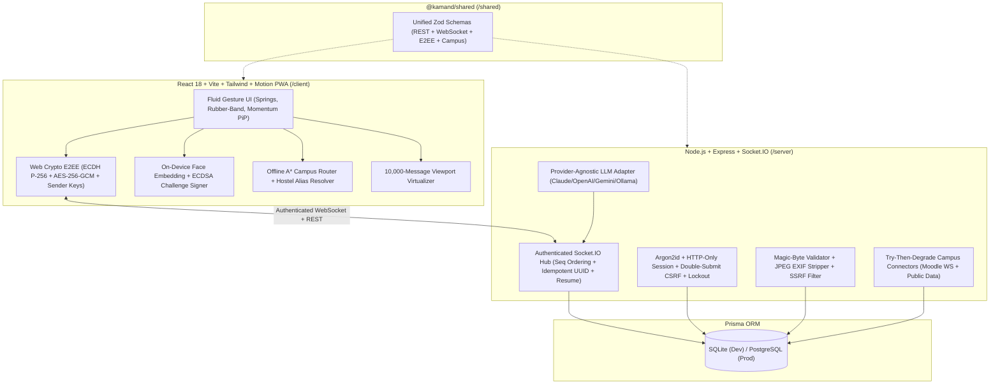

# Kamand Chat

**Start with a conversation. Build whatever comes next.**  
Built for **First Commit** (24-Hour Hackathon by Kamand Prompt, Programming Club, IIT Mandi).

Kamand Chat is a fast, private, real-time web messenger and campus companion built specifically for the IIT Mandi community. It pairs sequence-verified WebSocket messaging, Web Crypto end-to-end encryption (E2EE), on-device biometric face login, E2EE WebRTC calls, an opt-in AI assistant, degrade-gracefully campus connectors, and an offline-capable campus map with an Apple WWDC-inspired fluid physics interface.

---

## 1. Clean-Environment Quick Start (Runs in 1 Command)

### Prerequisites
- **Node.js** `>= 20.x` and **npm** `>= 10.x` (or Docker + Docker Compose)

### Local Setup & Run
```bash
# 1. Copy environment configuration files
cp server/.env.example server/.env
cp client/.env.example client/.env

# 2. Install dependencies, compile shared contracts, push SQLite schema & seed 1 super_admin + 6 demo users
npm run setup

# 3. Start both backend (http://localhost:4000) and frontend (http://localhost:5173)
npm run dev
```

### Docker Compose Run
```bash
docker-compose up --build
```

### Seeded Demo Accounts (Password for all: `Kamand@2026!`)

| Username | Email | Role | Hostel Room |
| --- | --- | --- | --- |
| `admin` | `admin@iitmandi.ac.in` | `super_admin` | `D-01` |
| `aravind` | `b23101@students.iitmandi.ac.in` | `member` (Community Admin) | `B-19` |
| `priya` | `b23142@students.iitmandi.ac.in` | `member` | `A-12` |
| `rohan` | `b22088@students.iitmandi.ac.in` | `moderator` | `C-10` |
| `ananya` | `b24019@students.iitmandi.ac.in` | `member` | `B-12` |
| `kabir` | `b25110@students.iitmandi.ac.in` | `member` | `B-19` |
| `meera` | `b23055@students.iitmandi.ac.in` | `admin` | `A-12` |

---

## 2. System Architecture



---

## 3. End-to-End Encryption (E2EE) Threat Model & Limitations

### What is Protected

1. **Per-Device Identity Keys**: Each browser generates a non-shared ECDH P-256 identity keypair and ECDSA P-256 signing keypair via the Web Crypto API (`client/src/lib/e2ee.ts`). Private keys remain in local device storage and can be backed up only after wrapping with a user-chosen PIN via `PBKDF2-SHA256` (100,000 iterations) + `AES-256-GCM`.
2. **1:1 Messaging**: Peers derive a shared 256-bit `AES-GCM` conversation key via `ECDH` + `HKDF-SHA256` domain-separated by `conversationId`. Every message uses a fresh 96-bit random IV/nonce. When `ciphertext` and `nonce` are transmitted, the server overwrites `body` with `"[E2EE]"` so database dumps contain zero plaintext.
3. **Group Messaging (Sender Keys)**: Group senders generate a 256-bit `AES-GCM` Sender Key distributed in encrypted envelopes to each member. Removing a member from a community automatically purges their keys and increments `senderKeyGeneration` across all channels (`e2ee:rotate-sender-keys`).
4. **Voice & Video Calls**: 1:1 and group mesh WebRTC streams apply Insertable Streams frame payload encryption (`transformEncodedMediaFrame`) and rotate the media key generation whenever a participant leaves a group call.
5. **Active MITM Detection**: Users can verify a 60-digit deterministic **Safety Number** (and scannable QR code) derived from both peers' identity public keys. If a peer's identity key changes, a visible amber warning banner is displayed inside the chat.

### Known Cryptographic Simplifications & Threat Model Boundaries

* **Simplification vs Full Double Ratchet**: For 1:1 chats within the 24-hour hackathon scope, keys are derived via static-ephemeral ECDH + HKDF per conversation with random 96-bit nonces per message rather than a per-message Diffie-Hellman ratchet step.
* **Metadata Visibility**: The server necessarily observes conversation membership, sender/recipient IDs, timestamps, and sequence numbers (`seq`) to route real-time packets.
* **Endpoint Compromise**: If a user's browser environment is compromised by malicious extensions or physical access while unlocked, local decrypted messages are readable.

---

## 4. On-Device Face Recognition Login & Spoofing Limits

* **100% On-Device Biometrics**: Camera frames are processed locally in the browser (`client/src/lib/faceAuth.ts`). Raw images are **never** uploaded; the server explicitly rejects any `/api/face/enroll` payload containing `data:image/*`.
* **Cryptographic Challenge-Response**: On login, the server issues a single-use, 2-minute random challenge nonce. After verifying the liveness gesture (`blink` / `turn_left` / `turn_right`) and embedding distance (`<= 0.48`) locally, the client unlocks its device-bound `ECDSA P-256` private key and signs `${challenge}:${deviceId}:${livenessGesture}`. The server verifies this cryptographic signature and rejects replayed or expired challenges.
* **Spoofing Limitations**: Standard 2D webcam liveness checks cannot match dedicated 3D infrared depth sensors (like Apple Face ID hardware). Therefore, Face Login is offered strictly as a device-bound convenience shortcut / 2FA alongside Argon2id passwords and Google OAuth fallback, with one-tap **Delete Face Data** in Security Settings.

---

## 5. Privacy Policy & Data Handling

| Data Category | What is Read | Where Stored | Retention & How to Delete |
| --- | --- | --- | --- |
| **Chat Messages** | Ciphertext + sequence metadata | SQLite/PostgreSQL + local browser | Delete for me / Delete for everyone at any time |
| **AI Context** | **Only** messages checked in the explicit consent preview | Ephemeral in-memory during LLM call | Never stored by AI adapter; opt-in per request |
| **Moodle / LMS Token** | Enrolled courses, deadlines, own grades | Encrypted at rest with per-user HKDF AES-256-GCM key | One-tap **Disconnect & Delete Cache** purges token + cache |
| **Campus Geolocation** | `watchPosition` coordinates for walking route | **On-device browser memory only** (never sent to server) | One-tap **Stop GPS** or **Revoke Now** on live ETA share |
| **Face Biometrics** | 64-float encrypted descriptor + ECDSA public key | Device-encrypted template | One-tap **Delete Face Data** in Security sheet |

---

## 6. How to Find and Set Real IIT Mandi Campus URLs

By default, `server/src/campus/campus.config.ts` ships with safe placeholder URLs and `DEMO_MODE=true` so the application runs out-of-the-box without hitting live institute servers. To connect to live IIT Mandi services:

1. **Moodle LMS (`MOODLE_BASE_URL`)**: Set `MOODLE_BASE_URL="https://lms.iitmandi.ac.in"` in `server/.env`. Students can generate their personal token in Moodle under **Preferences → Security keys → Moodle mobile web service** or paste their **Calendar Export ICS URL**.
2. **Campus Map (`campus-map.geojson`)**: Run `npx tsx server/src/campus/map/overpassImport.ts` with internet access to pull real OpenStreetMap building footprints for the Kamand valley bounding box, or refine pins live in the **Admin Map Editor**.

---

## 7. Verification Commands

```bash
# Static TypeScript check across all 3 workspaces
npm run typecheck

# Run all 10 Server & Client unit/integration test suites
npm test

# Run automated smoke script
npx tsx scripts/smoke.ts

# Run multi-browser Playwright E2E suite
npm run test:e2e
```
